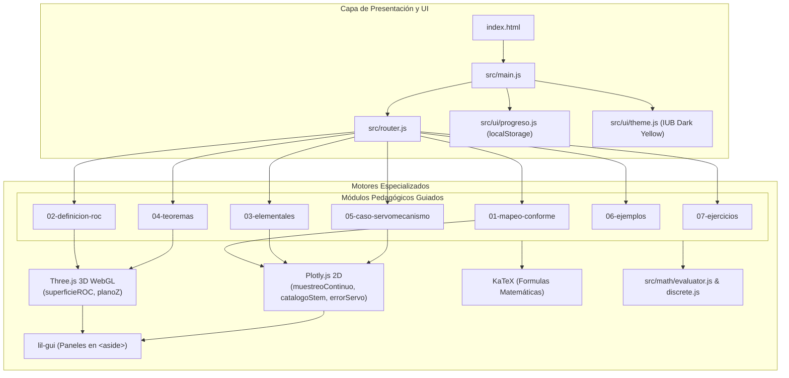

# Arquitectura del Sistema — Plataforma Didáctica Transformada Z

> **MEC36 — Control II** · Institución Universitaria de Barranquilla (IUB)

---

## 1. Responsabilidades por Motor (Filosofía de No-Solapamiento)

Para garantizar un rendimiento de 60 FPS estables y un código desacoplado y mantenible, cada motor tiene una responsabilidad única:

| Motor | Responsabilidad Única | Justificación y Regla Anti-Solapamiento |
| :--- | :--- | :--- |
| **Three.js** | Visualizaciones 3D en tiempo real (WebGL) | Superficie $|X(z)|$, cilindro de ROC y plano Z con polos/ceros móviles. **Nunca** se usa Three.js para dibujar gráficas 2D cartesianas simples. |
| **Plotly.js** | Gráficas bidimensionales científicas | Stem plots discretos, comparación de señales analógicas/muestreadas y respuesta de error. Se usa `Plotly.react()` para actualizaciones sin recrear el DOM. |
| **KaTeX** | Renderizado de fórmulas matemáticas | Todas las fórmulas en HTML se renderizan como vectores matemáticos puros (con salida MathML para accesibilidad). **Nunca** se usan imágenes estáticas. |
| **math.js** | Evaluación simbólica segura | Valida expresiones con regex de caracteres seguros y límite de tiempo (máx. 50 ms). **Prohibido el uso de `eval()` o `new Function()` sin sanitización.** |
| **GSAP** | Transiciones UI y animaciones de página | Maneja el tween de la barra de progreso, microinteracciones de botones y respeto a `prefers-reduced-motion`. **No** compite con el render loop de Three.js. |
| **lil-gui** | Controles de parámetros interactivos | Paneles de sliders y selectores ubicados **siempre fuera** del canvas o área de datos (en `<aside>` dedicado). |

---

## 2. Diagrama de Flujo del Sistema

---

## 3. Modelo de Seguridad y Evaluación Matemática

1. **Amenaza:** Inyección de código malicioso mediante cadenas matemáticas introducidas o manipuladas dinámicamente.
2. **Mitigación:** 
   - `src/math/evaluator.js` implementa una lista blanca estricta con la expresión regular `^[0-9a-zA-Z\s\+\-\*\/\^\(\)\.,_]+$`.
   - Longitud máxima restringida a 200 caracteres.
   - Ejecución acotada mediante `Promise.race` con un límite estricto de 50 ms para mitigar ataques de denegación de servicio por bucles infinitos.
   - Scope sanitizado aceptando únicamente valores numéricos finitos.

---

## 4. Gestión de Memoria y Ciclo de Vida WebGL

Cada escena 3D implementa la interfaz obligatoria `{ mount, update, resize, dispose, renderer }`:
- En `mount()`, se detecta compatibilidad con WebGL. Si falla, se muestra un fallback estático accesible sin bloquear la página.
- El bucle de animación se pausa automáticamente cuando la escena sale del viewport mediante `IntersectionObserver`.
- En `dispose()`, se recorre el grafo de escena liberando recursivamente geometrías (`geometry.dispose()`), materiales (`material.dispose()`) y forzando la pérdida de contexto en el renderer para evitar fugas de memoria GPU.
