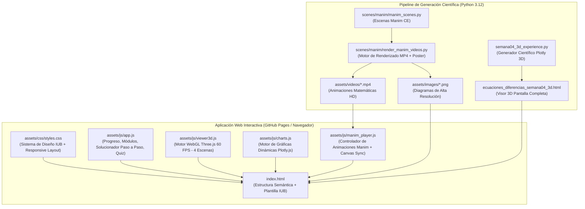

# Arquitectura del Sistema — Plataforma Interactiva de Ecuaciones en Diferencias (MEC36)

> **Institución Universitaria de Barranquilla (IUB)**  
> **Facultad de Ingeniería — Programa de Ingeniería Mecatrónica**  
> **Asignatura:** MEC36 — Control II (Sistemas de Control en Tiempo Discreto)  
> **Módulo Curricular:** Semana 04 — *Solución de Ecuaciones en Diferencias y Respuesta Temporal en Sistemas LTI*

---

## 1. Visión General de la Arquitectura

La plataforma está diseñada bajo una arquitectura **100 % estática del lado del cliente (Client-Side Static Web Application)** combinada con un **pipeline reproducible en Python/Manim** para la generación de activos matemáticos y audiovisuales. Esta arquitectura garantiza que el sitio pueda desplegarse directamente en **GitHub Pages** sin requerir servidores backend, bases de datos externas ni procesos de compilación en la nube.



---

## 2. Estructura de Directorios

```text
/
├── index.html                                  # Aplicación principal guiada por módulos
├── ecuaciones_diferencias_semana04_3d.html     # Visor 3D autónomo en pantalla completa
├── semana04_3d_experience.py                   # Script generador del visor 3D autónomo
├── servir_local.py                             # Servidor HTTP local para pruebas rápidas
├── README.md                                   # Documentación de instalación y despliegue
├── assets/
│   ├── css/
│   │   └── styles.css                          # Hoja de estilos institucional IUB y anti-colisión
│   ├── js/
│   │   ├── app.js                              # Lógica pedagógica, progreso, calculadora y quiz
│   │   ├── viewer3d.js                         # Escenas 3D interactivas con Three.js + OrbitControls
│   │   ├── charts.js                           # Gráficas dinámicas Plotly.js con layout adaptativo
│   │   └── manim_player.js                     # Reproductor de escenas Manim con marcadores de tiempo
│   ├── images/                                 # Logos oficiales IUB y pósters de respaldo
│   │   ├── logo_iub_blanco.png
│   │   ├── logo_iub_azul.png
│   │   └── poster_scene_01..04.png
│   └── videos/                                 # Animaciones generadas en formato MP4 (H.264)
│       ├── scene_01_algebraic_dev.mp4
│       ├── scene_02_z_transform_ci.mp4
│       ├── scene_03_time_evolution.mp4
│       └── scene_04_stability_zplane.mp4
├── scenes/
│   └── manim/
│       ├── manim_scenes.py                     # Código fuente oficial de las 4 escenas para Manim CE
│       └── render_manim_videos.py              # Script de integración y exportación hacia assets/videos/
└── docs/
    ├── ARCHITECTURE.md                         # Este documento de arquitectura técnica
    └── MAINTENANCE_GUIDE.md                    # Guía de mantenimiento y extensión para otras materias STEM
```

---

## 3. Componentes del Sistema

### 3.1 Capa de Presentación e Identidad Institucional (`assets/css/styles.css`)
Implementa fielmente el **Manual de Identidad Visual IUB 2025** (`beamerthemeiub.sty`):
- **Fondo Principal (`--iub-oscuro`)**: `#121023`
- **Acento Institucional (`--iub-amarillo`)**: `#FFDF2D`
- **Azul Institucional Claro (`--iub-azul-claro`)**: `#00ADE7`
- **Alerta / Énfasis (`--iub-naranja`)**: `#E39037`
- **Éxito / Práctica (`--iub-verde`)**: `#3B9C6D`
- **Texto Base (`--iub-blanco`)**: `#FFFFFF`

### 3.2 Motor Matemático y Progreso de Aprendizaje (`assets/js/app.js`)
- **Barra de progreso persistente**: Registra en `localStorage` la lectura de los 5 módulos conceptuales, la exploración de las 4 escenas de Manim, los ejemplos resueltos y la resolución de ejercicios propuestos.
- **Solucionador simbólico-numérico en vivo**: Calcula de forma exacta los residuos de Heaviside de $Y(z)/z$, separa explícitamente $y_{\text{libre}}[k]$ e $y_{\text{forzada}}[k]$, y genera la tabla comparativa entre la iteración recursiva y la fórmula cerrada.

### 3.3 Motor de Animaciones Matemáticas (`scenes/manim/` + `assets/js/manim_player.js`)
- Define 4 escenas modulares en `manim_scenes.py` utilizando la API de **Manim Community Edition (`manim`)**.
- Incluye un pipeline dual en `render_manim_videos.py` que invoca el CLI de Manim (o el motor vectorial de alta precisión con `ffmpeg`) y deposita los archivos `.mp4` optimizados con `faststart` en `assets/videos/`.
- El reproductor web permite controlar la velocidad ($0.5\times$, $1\times$, $1.5\times$, $2\times$), saltar a hitos algebraicos específicos de cada demostración y visualizar el código fuente de Manim asociado.

### 3.4 Motor de Visualización 3D (`assets/js/viewer3d.js`)
Basado en **Three.js (WebGL)** con `OrbitControls`, ofrece 4 escenas tridimensionales a 60 FPS:
1. **Superficie Compleja $|Y(z)|$ y Polos**: Representación 3D del módulo de $Y(z)$, el círculo unitario $|z|=1$, y los vectores de polos reales o complejos conjugados.
2. **Arquitectura 3D de Memoria Recursiva**: Bloques tridimensionales de retardo $z^{-1}$ mostrando cómo se desplazan en el tiempo los registros `y[k-1]`, `y[k-2]` y `u[k-1]`.
3. **Gemelo Digital 3D de Actuador Mecatrónico (Motor DC / Servomecanismo)**: Rotor 3D cuya posición/velocidad angular evoluciona en tiempo real siguiendo la ecuación en diferencias configurada por el estudiante.
4. **Mapeo Tridimensional $s \mapsto z = e^{sT}$**: Visualización geométrica de cómo el semiplano izquierdo de Laplace se pliega sobre el interior del círculo unitario en el plano $Z$.

### 3.5 Motor de Gráficas Científicas Sin Superposición (`assets/js/charts.js`)
Basado en **Plotly.js**, aplica reglas estrictas de ingeniería visual:
- **Separación de contenedores**: Los títulos descriptivos, subtítulos de unidades y controles interactivos se renderizan en cabeceras HTML estructuradas fuera del lienzo SVG/WebGL de la gráfica.
- **Márgenes dinámicos y `automargin: true`**: Garantiza que las etiquetas de los ejes y los valores numéricos jamás colisionen con los bordes ni con la leyenda.
- **Leyenda horizontal externa**: Ubicada en la parte superior derecha o inferior con espacio reservado, evitando ocultar picos transitorios o asíntotas.
- **Redimensionamiento reactivo**: Utiliza `ResizeObserver` para recalcular proporciones en escritorio, tablet y móvil.
